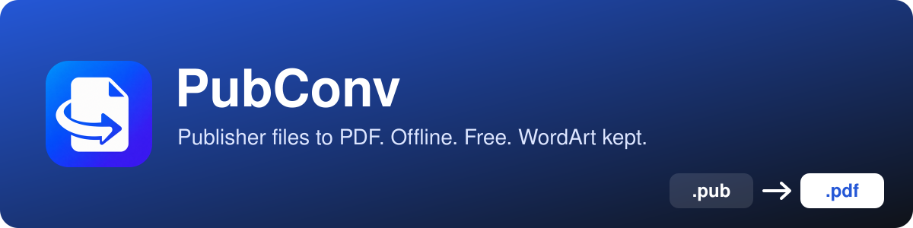
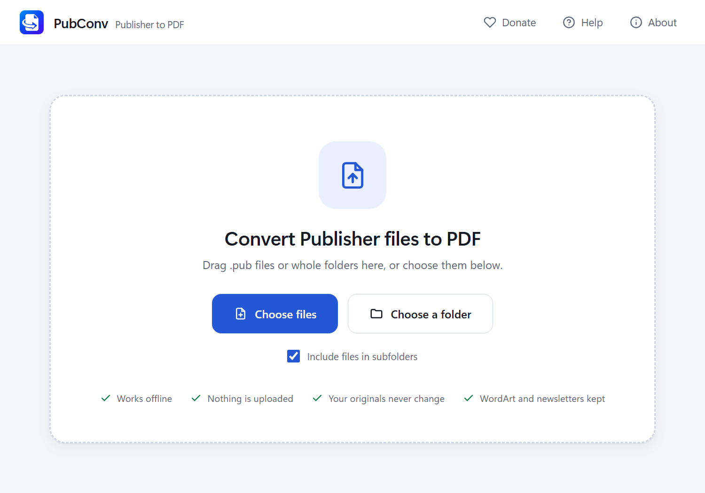
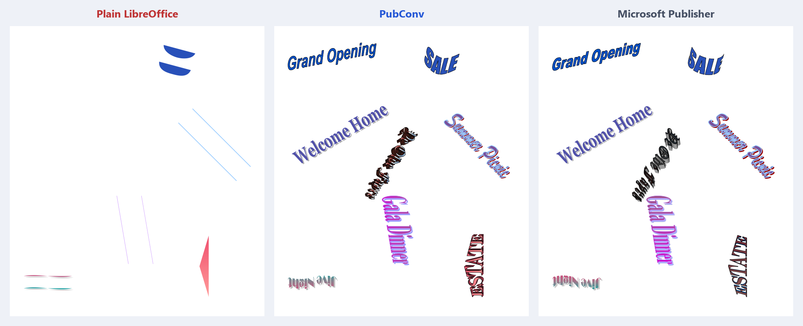

<div align="center">



<br><br>

[](https://github.com/rakawe86/pubconv/releases/latest)
[](https://www.paypal.com/ncp/payment/X45F9F8S58KL8)

[](https://github.com/rakawe86/pubconv/releases/latest)


**Convert Microsoft Publisher files to PDF, with your WordArt and newsletters intact.**<br>
Free, offline, and nothing to set up.

</div>

---

<table>
<tr>
<td width="50%" valign="top">

### ✨ Features

- 🎨 **WordArt kept**: curves, gradients, textures, 3D and shadows
- 📰 **Newsletters kept**: text flows through linked boxes the way Publisher does
- 🔤 **Mixed styles kept**: fonts, sizes and colours, word by word
- 🌀 **Text wrap**: follows the real shape, not just its box
- 🧩 **Groups**: nested and turned groups land in the right place
- 🌍 **Arabic and Hebrew**: drawn correctly, and you can search them
- 🔍 **Searchable PDFs**: text stays selectable and copyable
- 📂 **Whole folders**: convert many files at once
- 🔒 **Private**: works offline; nothing is ever uploaded
- 📦 **Self-contained**: no Publisher or anything else to install

</td>
<td width="50%" valign="top">



</td>
</tr>
</table>

## 💡 Why I built this

I noticed that many converters aren't free, and even then they lose WordArt and scramble linked text. Now that Microsoft is ending Publisher, people still need their files, so I decided to build this converter for everyone who needs it.

I built PubConv's own engine to fix that. It reads WordArt, linked stories, fonts, wraps and groups straight from the `.pub` file and lays them out the way Publisher does, checked against Publisher's own PDFs. For the page layout underneath, I use LibreOffice technology.

**Adnan**

## 🖼️ See the difference

The same file, converted three ways:



## 🚀 Quick start

| Step | |
|:---:|---|
| **1** | [**Download PubConv**](https://github.com/rakawe86/pubconv/releases/latest): the installer, or the portable zip for USB sticks |
| **2** | Open it. No admin rights needed |
| **3** | Drag in your `.pub` files or folders and click **Convert** |

> [!NOTE]
> **"Windows protected your PC"?** The GitHub download isn't code-signed yet. Click **More info → Run anyway**. A signed Microsoft Store version is coming.

## ❤️ Support PubConv

PubConv is free. If it saved you time, you can say thanks: **[Donate with PayPal](https://www.paypal.com/ncp/payment/X45F9F8S58KL8)**. Donations are optional and unlock nothing. Microsoft is not the recipient or sponsor of donations.

Found a file that converts badly? [Open an issue](https://github.com/rakawe86/pubconv/issues) and attach it if you can.

## ❓ FAQ

<details>
<summary><b>Do I need Microsoft Publisher?</b></summary>
<br>
No. PubConv reads <code>.pub</code> files by itself.
</details>

<details>
<summary><b>Are my files uploaded anywhere?</b></summary>
<br>
No. Everything happens on your PC, and no internet connection is needed. See <a href="PRIVACY.md">PRIVACY.md</a>.
</details>

<details>
<summary><b>Can I use it for many files?</b></summary>
<br>
Yes. Add whole folders in the app, or use <code>pubconv-cli.exe</code> for bulk and scripted jobs.
</details>

<details>
<summary><b>Does anything still look different from Publisher?</b></summary>
<br>

- **WordArt fills:** a fill picture that is a transparent PNG, BMP or EMF is drawn in dark grey. Pattern fills use their main colour. 3D lighting is approximate, so some metallic presets look brighter than in Publisher. Text around a full circle is approximate.
- **Text wrap:** tight wrap follows common shapes, freeforms and edited wrap outlines. Less common preset shapes (hearts, clouds, callouts) wrap around their box.
- **Linked text:** fonts, sizes, bold, italic, colours, alignment and spacing are kept. Underlines, indents, bullets and tabs in linked text are not drawn, and theme colours print black.
- **Groups:** a flipped group isn't mirrored, and a filled text box or picture in a turned group is left to the page engine, which doesn't turn it.

</details>

## 🛠️ For developers

<details>
<summary><b>How it works</b></summary>
<br>

```
.pub ─► pubcore reads WordArt, text stories, styles, linked chains, page layout
     └► patched copy (WordArt outlines + duplicated linked text removed) ─► page engine ─► base PDF
pubcore: shapes WordArt (warped glyph outlines) + flows linked text Publisher's way ─► drawn onto the base PDF
```
Anything PubConv can't place confidently is left to the page engine, so output is never worse than LibreOffice alone. Text PubConv draws itself also gets an invisible text layer, so PDFs stay searchable and copyable.

Robustness:
- A damaged file falls back to plain conversion instead of stopping the batch.
- A hung page engine is stopped after a time limit.
- Same-named files saved to one folder get "(2)", "(3)".
- Read-only originals still get the full fixes.

</details>

<details>
<summary><b>Project layout</b></summary>
<br>

| Path | What |
|---|---|
| `crates/pubcore` | .pub reader, Publisher-style text flow, WordArt renderer, PDF overlay |
| `crates/pubconv` | conversion engine (`lib.rs`) and command line (`bin/pubconv-cli.rs`) |
| `crates/pubconv-app` | Windows app: window and WebView2 host (`src/main.rs`), interface (`ui/index.html`, open it in a browser for a design preview: `#list`, `#running`, `#done`) |
| `crates/pubconv-setup` | installer and uninstaller, styled like the app (`ui/index.html`, open it in a browser for a preview) |
| `packaging/` | release script: app folders, installer, portable zip, Microsoft Store (MSIX) package |
| `testdata/` | 113 test .pub files, Publisher's own PDFs (`reference/`), expected results (`fixtures/`) |
| `tools/` | stress test, comparison sheets, Publisher comparison scripts |
| `store/` | Microsoft Store listing texts and screenshots |

</details>

<details>
<summary><b>Build and test</b></summary>
<br>

Needs Rust with the MSVC toolchain (and Visual Studio's C++ build tools), Python 3 with `pillow pymupdf psutil`, and LibreOffice (on the build PC only).
```bash
cargo test --release
```
```bash
cargo build --release
```
```bash
python tools/stress_test.py
```
```bash
python packaging/build_release.py
```
Build output goes to `target/`, `.build/` and `dist/`, which Git ignores.

</details>

<details>
<summary><b>Test coverage</b></summary>
<br>

- **Unit and integration :**
  - every WordArt property of 40 shapes;
  - box positions to 0.01 pt;
  - linked-text breaks identical to Publisher (17/17), and every line identical (38/38, 33/33);
  - render planning, patching and page mapping.
- **Fuzzing:** 4,920 damaged files per run by default; 24,600 with `FUZZ_PER_FILE=300`. Zero crashes allowed.
- **End to end (`tools/stress_test.py`):**
  - accuracy against Publisher's PDFs;
  - searchable output;
  - 1,040 files in deep folders with awkward names;
  - same-named files saved into one folder;
  - damaged and fake files;
  - PDFs locked by another program;
  - read-only originals.
- **Hard documents (`tools/hard_compare.py`):** 31 complex Publisher documents in `testdata/hard` (8–60 page newsletters with jumping stories, all 40 WordArt shapes, 11 languages, columns, booklets, tri-folds), scored against Publisher's own PDFs and against plain LibreOffice. Latest: flow 98.4%, text recall 99.4%, duplicated text 0.1% (LibreOffice: 64%, 87%, 37%); 162 of 308 linked boxes start on exactly Publisher's character. Remaining differences are mostly hyphenation: Publisher uses Microsoft's own dictionary, which no public pattern set reproduces. `tools/tune_flow.py` compares each box's starting character with Publisher's.

</details>

## 📄 Licence

MPL-2.0. Bundled LibreOffice components are MPL-2.0; other dependencies are MIT/Apache. See `packaging/THIRD-PARTY-NOTICES.txt`. Microsoft and Publisher are trademarks of Microsoft Corporation; PubConv is not affiliated with Microsoft.

---

<div align="center">

**Built in the UAE :united_arab_emirates:, for the world**

</div>
